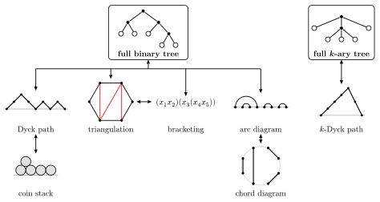
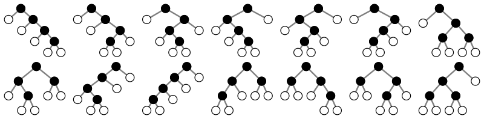
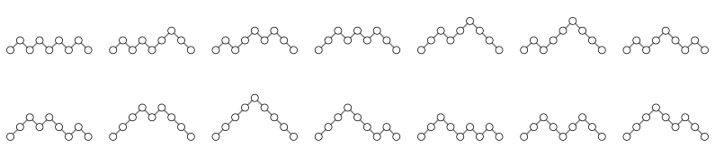
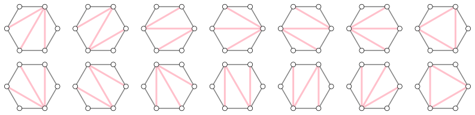
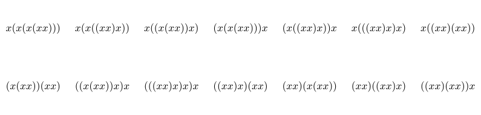
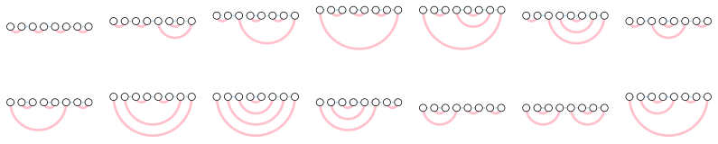
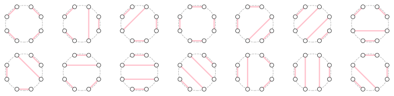
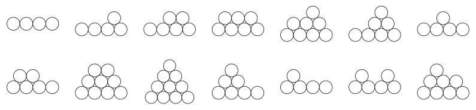

# A Personal Note
I started this project in 2023. Then my health fell apart, and the project stalled for a long time. I finally finished it in November 2026.

Honestly, with how far AI has come, finishing it felt kind of pointless. But I had fun doing this project regardless.

---
# Usage
Build it first (see [Compile Instruction](#Compile-Instruction)), then run `./catalan_toolbox` and type a command:
```
  plot <form> <size> [count]  draw random objects of one form
  enu[merate] <form> <size>   save every object of one size as an svg
  flip <vertices>             flip the diagonals with its dual tree beside it
  show <internal nodes>       draw one random object in all seven forms
  avoid <form> <size>         list the objects that avoid given patterns
  test [form]                 run the tests (every form if none is given)
  help                        show help menu
  q[uit]                      quit

  FORM                  SIZE
  tri[angulation]       vertices
  brackets              factors
  chords, arcs          chords or arcs
  dyck                  k (plot only), then down-steps
  coins                 coins in the bottom row
  tree                  k (plot only), then internal nodes
```
For example, `plot tri 8` draws a random triangulation of an octagon.

- Every `plot` window has a button for each form.
- In a `flip` window, click a diagonal to flip it.
- `enu` and `avoid` save their svg files into a folder in `out/`.

---
# Conversion Flow


---
# Galleries
Here shows the visualization for `catalan(4)` in each Catalan structure. There are 14 of them for each. 

For `catalan(5)`, please click [here](galleries/readme/c5/README.md) (42 of them for each Catalan structure).









---
# Milestones
### Generalized Catalan Tree generator
- [x] A verifiably random generator for full `k`-ary tree

### Tree
- [x] Visualizer for full `k`-ary trees
- [x] Gallery for $C_4$ and $C_5$

### Dyck Path
- [x] Convert between `r`-dyck path pre-order bit string and tree in `O(n)`
- [x] Visualizer for `r`-dyck path
- [x] Verify a given path is a valid `r`-dyck path or not
- [ ] Flip mountain
- [x] Gallery for $C_4$ and $C_5$

### Triangulation
- [x] Convert between polygon triangulation and binary tree in `O(n)`
- [x] Visualizer for polygon triangulation
- [x] Triangulation flip in `O(1)` with `O(n)` pre-processing and visualize the result
- [x] Verify a given polygon triangulation is a valid polygon triangulation or not
- [x] Gallery for $C_4$ and $C_5$

### Bracketing
- [x] Convert between bracketing and binary tree in `O(n)`
- [x] Convert between bracketing and polygon triangulation in `O(n)`
- [x] Visualizer for bracketing
- [x] Verify a given bracketing is a valid bracketing or not
- [x] Gallery for $C_4$ and $C_5$

### Non-intersecting Chord Graph
- [x] Convert between non-intersecting chord graph and binary tree in `O(n)`
- [x] Visualizer for non-intersecting chord graph
- [ ] Exchange a chord and visualize the result
- [x] Verify a given chord graph is a valid non-intersecting chord graph or not
- [x] Gallery for $C_4$ and $C_5$

### Non-crossing Arcs
- [x] Convert between non-crossing arcs and binary tree in `O(n)`
- [x] Visualizer for non-crossing arcs 
- [ ] Exchange an arc and visualize the result
- [x] Verify a given arcs is a valid non-crossing arcs or not
- [x] Gallery for $C_4$ and $C_5$

### Coin Stack
- [x] Convert between coin stack and Dyck path
- [x] Visualizer for coin stack
- [x] Gallery for $C_4$ and $C_5$

### Enumeration
- [x] Package Mutze codes into a C++ library.
- [x] Use the above to enumerate pattern avoiding binary trees.
- [x] Generalize the above to all Catalan structures.
- [x] Plot the patterns and ask users to confirm the patterns.
- [x] Plot pattern avoiding Catalan structures.
- [x] Save all of the above as svg files onto the disk.
- [ ] Able to enumerate generalized Catalan structures lexicographically via an iterator.

### Visualizer
- [x] Draw everything with matplotlib
- [x] Draw one object in all seven forms side by side
- [x] Switch a window between forms with buttons
- [x] Fit every window on the screen

### Other
- [ ] A website that hosts all visualization for well-known Catalan structures for `n >= 3 to n < ?`.

---
# Compile Instruction
## C++23
The `Makefile` uses `-std=c++23`, so make sure your `g++` compiler version supports it (g++ 14 or newer).

## MacOS
Install g++-14 from [Homebrew](https://brew.sh).

## Linux on ARM
The Makefile links `lib/libmutze_aarch64.a` instead of `lib/libmutze.a`.

## Steps To Follow
- Run `./install.sh`

This will create a python virtual environment, install all dependencies, and then run Makefile.

The provided script has been tested on:
- Ubuntu 26.04 on WSL2

----
# Related Work
## Tree
### Height of Tree
- [The Average Height of Binary Trees and Other Simple Trees](https://algo.inria.fr/flajolet/Publications/FlOd82height.pdf)
- [ON THE HEIGHT OF TREES](https://www.cambridge.org/core/journals/journal-of-the-australian-mathematical-society/article/on-the-height-of-trees/C30DF2A9C26541526D847E0A0D46F2A8)
- [Variance of Height of Tree](https://math.stackexchange.com/questions/660698/variance-of-height-of-tree)
- [How to analyze this expected number of a random tree?](https://codeforces.com/blog/entry/95463)
### Tree Generation
- [Counting and Randomly Generating k-Ary Trees](https://www.scirp.org/pdf/am_2021122213413624.pdf)
- [Counting k-ary labelled trees](https://math.stackexchange.com/questions/145515/counting-k-ary-labelled-trees)
- [Prüfer Codes of Labeled Trees](https://demonstrations.wolfram.com/PruferCodesOfLabeledTrees/)
- [Prüfer Code](https://mathworld.wolfram.com/PrueferCode.html)
- [Prüfer Code](https://cp-algorithms.com/graph/pruefer_code.html)
### Tree Enumeration
- [Lexicographic Enumeration of k-ary Trees](https://www.tandfonline.com/doi/abs/10.1080/02522667.1985.10698815)
- [Efficient loopless generation of Gray codes for k-ary trees](https://www.sciencedirect.com/science/article/abs/pii/S0020019000001393)
- [Generating Binary Trees by Rotations](https://webhome.cs.uvic.ca/~ruskey/Publications/Rotation/Rotation.html)
- [The Greedy Gray Code Algorithm](https://link.springer.com/chapter/10.1007/978-3-642-40104-6_46)

### Pattern Avoiding Trees Enumeration
- [COMBINATORIAL GENERATION VIA PERMUTATION LANGUAGES. VI. BINARY TREES](https://arxiv.org/pdf/2306.08420)
- [The Combinatorial Object Server](http://www.combos.org/btree)
- [Efficient algorithms for generating pattern-avoiding combinatorial objects](https://2023.permutationpatterns.com/p/mutze.pdf)

### Edge Flip Tree Graph has a Hamiltonian path and cycle 
- [The Rotation Graph of Binary Trees is Hamiltonian](https://www.cs.princeton.edu/techreports/1986/021.pdf)

---
## Dyck Paths
- [Raised k-Dyck Paths](https://cs.uwaterloo.ca/journals/JIS/VOL26/Drube/drube12.pdf)
- [On a generalisation of k-Dyck paths](https://scholar.sun.ac.za/server/api/core/bitstreams/1e3e820c-7bf3-4362-abe4-0684b1f94d0f/content)
- [COMBINATORICS OF r-DYCK PATHS, r-PARKING FUNCTIONS, AND THE r-TAMARI LATTICES](https://arxiv.org/pdf/1202.6269)

---
## Triangulation
- [Common edges in rooted trees and polygonal triangulations](https://personal.math.ubc.ca/~andrewr/pubs/triangulations.pdf)
- [Rotation Distance, Triangulations, and Hyperbolic Geometry](https://www.cs.cmu.edu/~sleator/papers/rotation-distance.pdf)
- [Convex polygon triangulation based on planted trivalent binary tree and ballot problem](https://www.researchgate.net/publication/330544850_Convex_polygon_triangulation_based_on_planted_trivalent_binary_tree_and_ballot_problem)
- [Graph of triangulations of a convex polygon and tree of triangulations](https://web.mat.upc.edu/marc.noy/uploads/2013/05/graph-triangulations.pdf)
- [Properties of Random Triangulations and Trees](https://www.researchgate.net/publication/220453462_Properties_of_Random_Triangulations_and_Trees)

---
## Catalan Structures
- Richard P. Stanley - Catalan Numbers-Cambridge University Press (2015)
- [Information on Enumerative Combinatorics](https://math.mit.edu/~rstan/ec/)
- [Bijection Between Catalan Objects](https://www.math.unl.edu/~tlai3/Catalan%20Objects.pdf)
- [Catalan Numbers](http://www.geometer.org/mathcircles/catalan.pdf)
- [CATALAN NUMBERS](https://pi.math.cornell.edu/~karola/dimex/catalan.pdf)
- [Catalan Numbers, Their Generalization, and Their Uses](https://www.math.uakron.edu/~cossey/636papers/hilton%20and%20pedersen.pdf)

---
## Counting
- [Non-Contiguous Pattern Avoidance in Binary Trees](https://www.combinatorics.org/ojs/index.php/eljc/article/view/v19i3p22/pdf)
- [Generating Function ELI5](https://www.reddit.com/r/explainlikeimfive/comments/1e0h10/eli5generating_functions/)

---
## Super Catalan
- [Elements of the sets enumerated by super-Catalan numbers](https://math.haifa.ac.il/toufik/enumerative/supercat.pdf)

---
## Mixing Time
- [On the Mixing Time of the Triangulation Walk and other Catalan Structures](https://tetali.math.gatech.edu/PUBLIS/mt.pdf)
- [Improved Mixing for the Convex Polygon Triangulation Flip Walk](https://drops.dagstuhl.de/entities/document/10.4230/LIPIcs.ICALP.2023.56)
- [Polynomial mixing time of edge flips on quadrangulations](https://arxiv.org/abs/1809.05092)

---
## Other
- [A Transformation of the Catalan Numbers and Related Counted Sets](https://shareok.org/bitstream/handle/11244/323386/Davis_okstate_0664M_16189.pdf?sequence=1&isAllowed=y)
- [AN ENUMERATIVE-PROBABILISTIC STUDY OF CHORD DIAGRAMS](https://etd.ohiolink.edu/acprod/odb_etd/ws/send_file/send?accession=osu1373310487&disposition=inline)

---
# License
Copyright (C) 2023-2026 Aorta3698

Licensed under the GNU General Public License. See [LICENSE](LICENSE).

`lib/` holds Torsten Mütze and Namrata's [pattern-avoiding binary tree code](http://www.combos.org/code/btree/btree.zip).
